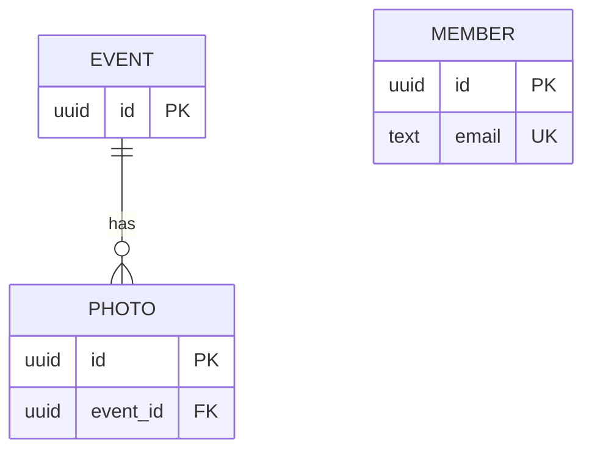

# Club Photos — Data & API Design

> **Example.** This is a filled-in version of `data-api-design.md` for the photo-club app, shown as it looks after the Week 7 fixes. Use it to see the level of detail expected — not as text to copy.
>
> **Version:** 1.1
>
> **Approved on:** 2026-10-23 **by:** Architecture Lead Priya Shah · Product Owner Sam Rivera · Delivery Lead Alex Kim

---

## 0. Database & Storage

**Database:** PostgreSQL via Supabase (ADR-00 in `plan.md`).

**Build option:** Simulated backend (Supabase in System Implementation)

**We store:** Members and their role, events, and the uploaded photos for each event. Photo files live in the Supabase Storage bucket `photos`; the `photo` table stores only each file's path. In this course's simulated build, sample photos use image links, and uploaded photos last only until the page reloads (ADR-01).

**We do NOT store:** Passwords (login is by emailed link, ADR-02 in `plan.md`), member names (no requirement needs them), who uploaded each photo.

**Sensitive fields:** `member.email` — only visible to that member and to admins.

---

## 1. Entities

**Entity: Member**

| Field | Type | Key | Required? | Req ID |
|-------|------|-----|-----------|--------|
| id | uuid | PK | Yes | R1 |
| email | text | Unique | Yes | R1 |
| role | text (`member` or `admin`) | | Yes | R5 |

**Entity: Event**

| Field | Type | Key | Required? | Req ID |
|-------|------|-----|-----------|--------|
| id | uuid | PK | Yes | R2 |
| name | text | | Yes | R2, R9, R10 |
| event_date | date | | Yes | R2, R8, R10 |

**Entity: Photo**

| Field | Type | Key | Required? | Req ID |
|-------|------|-----|-----------|--------|
| id | uuid | PK | Yes | R3 |
| event_id | uuid | FK → Event (on delete: block — deleting is out of scope) | Yes | R3 |
| file_path | text | | Yes | R6 |

Member has no relationships: nothing in the Spec needs to know who uploaded a photo.

---

## 2. Entity Relationship Diagram (ERD)

---

## 3. Normalization Check

- [x] **1NF** — every field holds one value.
- [x] **2NF** — every field depends on the whole primary key.
- [x] **3NF** — no field depends on another non-key field. (A photo's event name and date come from `event_id`; they aren't stored on the photo.)

**Intentional exceptions:** None.

---

## 4. API Endpoints

Every endpoint except the login endpoints requires login (R1).

| Req ID | Method | Path | Request | Success response | Errors | Who can call it |
|--------|--------|------|---------|------------------|--------|-----------------|
| R1 | POST | /v1/login | `{ email }` | 200 `{ sent: true }` — emails a login link (simulated: the picker sends the chosen member's `id` and logs in at once) | 400 missing email | Anyone |
| R1 | GET | /v1/me | — | 200 `{ id, email, role }` | 401 | Member |
| R1 | POST | /v1/logout | — | 204 | — | Member |
| R1 | GET | /v1/users | — | 200 `[{ id, email, role }]` — **simulated only**, lists the sample members for the "log in as…" picker; not built in System Implementation | — | Anyone |
| R2 | GET | /v1/events | — | 200 `[{ id, name, event_date }]`, newest first | 401 | Member |
| R9 | GET | /v1/events?search={text} | — | 200 matching events (`[]` if none) | 401 | Member |
| R10 | POST | /v1/events | `{ name, event_date }` | 201 `{ id, name, event_date }` | 400 missing name or date, 401, 403 | Admin |
| R3, R4, R12 | GET | /v1/events/{id}/photos | — | 200 `[{ id, url }]` (`[]` if no photos) | 401, 404 event not found | Member |
| R5, R6, R7 | POST | /v1/events/{id}/photos | Photo files (form upload) | 201 `{ uploaded: [{ id, url }], rejected: [{ filename, reason }] }` | 401, 403 not an admin, 404 event not found | Admin |
| R8 | GET | /v1/photos/{id} | — | 200 `{ id, url, event_name, event_date }` | 401, 404 | Member |

`url` isn't stored: it's built from the photo's `file_path` — a Supabase Storage link in the real design, and the image link itself in the simulation (ADR-01). `event_name` and `event_date` come from the photo's event. The gallery builds each photo's alt text (R12) from the event name and the photo's place in the list.
