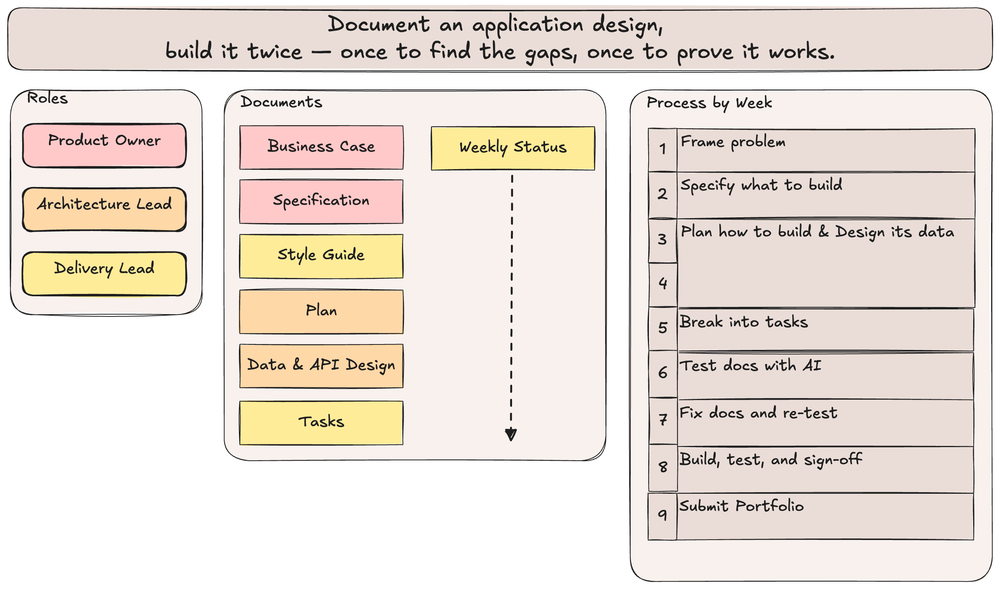

# Team Project Schedule, Rubrics & Presentation

**What this project is:** In this System Design project, your team designs a small product through a set of documents — the business case, specification, style guide, data and API design, plan, and tasks. **The documents are what you're graded on.** You'll build the product twice with an AI agent, one task at a time — first to find gaps in your documents, then to show your design works — but the builds exist to test your design, not to be production software. Your documents are also the handoff to System Implementation, where you can continue the project with a real backend.

#### Visual Overview


## Roles

| Role | Owns | Also |
|---|---|---|
| **Product Owner** | Business Case, Specification | Answers open questions from the other roles; leads the Week 3 prototype test |
| **Architecture Lead** | Plan, Data & API Design | Reviews the Spec for feasibility |
| **Delivery Lead** | Style Guide, Tasks, Weekly Status | Runs the Week 6 validation build |

While teams of 3 are the preference, teams of 4 can work. In this case, two people share the Architecture Lead role and split its documents, where one person owns the *Plan* and the other owns *Data & API Design*. Everywhere else, both act as Architecture Lead — for example, both sign each document's approval line.

* Everyone reviews every document each week, but each document has exactly one owner.
* Every week ends with a Weekly Status entry — see [Weekly Status](#weekly-status) below.
* Every document has a template in `docs/`, a short guide in `docs/reference/`, and a filled-in example in `docs/examples/`. New to a term? See `docs/reference/glossary.md`.

---

## The Process at a Glance

| Week | Focus | Main documents |
|---|---|---|
| 1 | Frame the problem | `business-case.md`, Constitution (Section 0 of `specification.md`) |
| 2 | Specify what to build | `specification.md`, `style-guide.md` |
| 3–4 | Plan how to build it, and design its data | `plan.md`, `data-api-design.md` |
| 5 | Break it into tasks and check the docs agree | `tasks.md` |
| 6 | Test the docs with an AI build of the P1 scenarios | Gap log (Section 3 of `tasks.md`) |
| 7 | Fix the docs, then re-run the AI build | All docs |
| 8 | Build, test, and sign off | All docs |
| 9 | Submit your portfolio: video and combined document | All docs |

**Priorities:** every scenario in the Spec is tagged **P1** (must have), **P2** (should have), or **P3** (nice to have). The P1 scenarios together are the smallest version of the product that still solves the problem — that's what gets built first, and it's the only thing built in Weeks 6–7.

**The one rule that applies every week:** if something is wrong, fix the document first, then anything that depends on it (Spec → Style Guide / Data & API Design / Plan → Tasks → code). The documents are the source of truth.

**Versions and approval:** each document's header holds its version and an approval line. Whenever an approved document's content changes, its owner bumps the version (1.0 → 1.1) and the team re-approves it by updating the names and date. Adding Open Questions rows or changing task statuses doesn't count as a change, and Tasks has no version.

**Using AI on the documents.** You may use AI to draft, critique, or tighten a document, but your team owns every word in it.
- **Evidence comes from real people.** AI-written quotes, personas, or survey results never go in the Evidence table.
- **The team makes the decisions.** Priorities, the Constitution, ADR choices, and approvals are yours. AI can suggest options, but it doesn't choose.
- **Check everything it adds.** AI fills gaps with plausible guesses, which is the same problem the Week 6 build exposes. If you can't explain a line, cut it.
- **Say how you used it.** Add an **AI use** line to each Weekly Status entry (e.g. "Claude drafted the first EARS requirements; Sam rewrote them").

---

## Weekly Status

Every week, your team adds a short entry to `docs/WEEKLY-STATUS.md`. It's how your instructor follows your progress, and it's checked for the "weekly update" requirement independent of the deliverable rubric below.

- **Who:** the Delivery Lead owns the file, and everyone contributes their own part.
- **When:** add the week's entry at the top, and sync it, before your weekly deadline.
- **What:** what each person finished, what's next, blockers, open questions, and how you used AI. Fill in the template where it is, like every other document; a filled-in example is `docs/examples/weekly-status-example.md`.
- **Instructor access:** your instructor must be a collaborator on your repo (set up in Week 1) so they can read each entry and reply in it.
- **Instructor response:** your instructor replies in the same entry. This is also where change requests are approved or declined (see "Adapting the Process").

---

## Default Technical Stack

Your stack answers two separate questions, and the answers can differ:

- **Build option:** what you build in this course. The default is a simulated backend.
- **Database (designed for):** what your design targets in System Implementation. Your team picks it; the examples use PostgreSQL via Supabase.

Build with these defaults unless your team has a reason to choose otherwise. Record both answers, and any reason for changing a default, in `plan.md` ADR-00.

| | Test Build (this course) | Designed For (System Implementation) |
|---|---|---|
| **Data** | JSON files and browser storage | A real database your team names, e.g. PostgreSQL via Supabase |
| **Login** | A "log in as…" picker | Real login |
| **Frontend** | Vue with no build step, started from the course skills | Vue with no build step, started from the course skills |
| **Hosting** | GitHub Pages from the repo root | GitHub Pages stays; the database is hosted separately, e.g. by Supabase (or the host your team names) |

**Whether it's a simulated or real backend, these things stay the same in the data.** Your entities, field names, endpoints, and response shapes match `data-api-design.md` exactly. That allows System Implementation to replace the simulation with a real backend without redesigning anything. The photo-club examples show this: they simulate the backend now and plan for Supabase later.

**Agent instructions and course skills** come with the template repository. `CLAUDE.md` holds the project rules every AI build follows, and the course skills are in `.claude/skills/`. Both GitHub Copilot in VS Code and Claude Code read them, and the agent uses a skill automatically when it fits the task:

- `collection-template`: a browsable collection with detail pages (the starting point for most projects)
- `dashboard-template`: a grid of charts and KPI cards
- `simulated-login`: adds the "log in as…" picker and user roles
- `chat-panel`: adds a chat panel

Your documents say *what* to build; the skills show *how*.

**Teams can customize** their stack to their preferences, but the default is enough to meet the rubric. If your team wants to change it, record the change and reason in ADR-00 of `plan.md`.

- **A real backend** (a hosted database with real login) is fine if your team already has the experience. Your "Test Build" column then matches your "Designed For" column.
- **Another framework** is fine too, though one with a build step (such as React with Vite) has to publish through GitHub Actions instead of from the repo root.

**Repo layout** for the final test build:

```
/                        repo root: GitHub Pages serves the app from here
├── index.html, app.js, data.js, style.css
├── components/          the app's Vue components
├── data/                sample data, one JSON file per entity
├── .nojekyll            lets GitHub Pages serve the files as they are
├── .claude/skills/      course skills (don't edit)
├── .vscode/             turns on CLAUDE.md for Copilot in VS Code (don't edit)
├── docs/                your design documents and WEEKLY-STATUS.md, plus the guides and examples
├── validation/          Week 6 validation build (never committed; delete after Week 7)
├── CLAUDE.md            the agent's project instructions (don't edit)
└── README.md
```

Note: GitHub Pages sites are public, so sample data must be made up: never real people's names, emails, or photos.

---

## Adapting the Process

Every project is different. You can adapt the documents and schedule to fit yours — but some changes need your instructor's approval first.

**No request needed:**
- Marking a section "N/A because…"
- Adding rows, sections, or detail
- Choosing your own tech stack, database type, or build option

**Request needed:**
- Removing or replacing a section
- Moving a deliverable to a different week
- Changing how a rubric item will be met

**What can't be changed:** one owner per document · requirement IDs traced through every document · the Week 6 validation build and gap log · fixing the document before the code · the Week 9 portfolio submission.

**How to request a change:** add a **Change request** line to that week's `docs/WEEKLY-STATUS.md` entry at least one week before the affected deliverable. Say what you want to change, why, and what it affects. Your instructor will reply in the same entry with Approved or Declined and the date. Approved changes replace the original requirement when grading.

---

## How Documents Are Graded

Each document's SVC Self-Check is its rubric. In the weekly rubrics below, a document row means every self-check item for the sections due that week is true. The other rows grade your process.

---

## Week 1 — Kickoff & Business Case

**Deliverable:** `business-case.md` (first draft), Constitution (`specification.md` Section 0), roles assigned, repo created with all team members **and your instructor** added as collaborators.

**Setup:** the Delivery Lead creates the team repo from the course template repository (**Use this template → Create a new repository**), makes it public so GitHub Pages can publish it on a free account, and adds teammates and the instructor under **Settings → Collaborators**. Everyone then clones it (see GitHub Workflow below).

| Criteria | What it looks like |
|---|---|
| Business Case | Its SVC Self-Check passes, including the sponsor's decision |
| Roles & repo | All roles assigned (in a team of 4, the Architecture Lead role is split); repo exists with all members as collaborators |
| Instructor access | Instructor added as a collaborator (use the GitHub username given in class) so they can read and respond to your Weekly Status entries; `docs/WEEKLY-STATUS.md` has a Week 1 entry |
| Constitution | `specification.md` Section 0 has 2–3 principles that would actually stop a feature |

---

## Week 2 — Specification v1 & Style Guide

**Deliverable:** `specification.md` (draft: prioritized scenarios + EARS requirements + acceptance tests, plus Evidence from 3–5 conversations), `style-guide.md` (complete, team-approved).

| Criteria | What it looks like |
|---|---|
| Specification (draft) | Its SVC Self-Check passes, except the items that wait for Week 3: prototype-test evidence, open questions, and approval |
| Style Guide | Its SVC Self-Check passes, including the whole team's approval |

---

## Week 3 — Spec Refinement, Tech Stack & Data Model Draft

**Deliverable:** `specification.md` (open questions resolved, requirements tightened against feasibility, prototype test run and Evidence table updated), `plan.md` Sections 1–2 (approach, key decisions including the tech stack as ADR-00), `data-api-design.md` Sections 0–2 (database & storage, entities, ERD).

| Criteria | What it looks like |
|---|---|
| Specification | Its full SVC Self-Check passes, and it's approved |
| Prototype test | Any form of prototype; 3–5 people watched; at least one Spec change, or "no change, because…", recorded |
| Plan and Data & API (first half) | The SVC items for the sections due this week pass |
| Cross-review | Architecture Lead has flagged at least one Spec ambiguity back to PO (evidence iteration is happening) |

---

## Week 4 — Data & API Design and Plan Finalized

**Deliverable:** `data-api-design.md` Sections 3–4 (normalization, API endpoints), `plan.md` Sections 3–4 (screens & build order, risks & assumptions), both approved ahead of Week 5.

| Criteria | What it looks like |
|---|---|
| Data & API Design | Its full SVC Self-Check passes, and it's approved |
| Plan | Its full SVC Self-Check passes, and it's approved |

---

## Week 5 — Tasks & Cross-Check

**Deliverable:** `tasks.md` (sequenced backlog, traced to Requirement IDs), plus a cross-check (`tasks.md` Section 2) that all documents agree before the Week 6 build.

| Criteria | What it looks like |
|---|---|
| Tasks | The SVC items for the task list and cross-check pass, and it's approved |
| Cross-check | Every P1 requirement can be followed through the docs: acceptance test → entity/endpoint (if it stores data) → ADR or screen → task. No orphans in either direction |

---

## Week 6 — Validation Build

**Deliverable:** An AI build of the **P1 scenarios only**, run live with the whole team, using the full document suite and following Part A of the Build & Test guide (`docs/reference/build-and-test-guide.md`); gap log (`tasks.md` Section 3) filled in.

| Criteria | What it looks like |
|---|---|
| Whole-team participation | All members present and observing, not delegated to one person |
| Gap log completeness | Every place the agent guessed, stalled, or misread a doc is logged with which section caused it |
| Attribution | Gaps sorted to the correct owning document (Spec, Style Guide, Data & API Design, Plan, or Tasks) |
| Tone check | Log treats gaps as spec problems to fix, not code problems to patch around |

---

## Week 7 — Spec Gap Fixes & Re-run

**Deliverable:** All docs patched from the Week 6 gap log, each changed document with a version bump and a new dated approval; a short re-run of the P1 AI-build to confirm the fixes worked.

| Criteria | What it looks like |
|---|---|
| Fix coverage | Every logged gap has a corresponding fix, or a documented reason it wasn't fixed |
| No silent drift | Changes are visible as real diffs/commits, each with a clear message; every changed document has a new version and a dated re-approval |
| Doc consistency | All documents agree with each other after fixes (no orphaned references) |
| Re-run | Fixed gaps don't recur in the re-run; any new gaps are logged |

---

## Week 8 — Final Test Build & Sign-off

**Deliverable:** A working (rough is fine) AI-assisted build produced by following Part B of the Build & Test guide against Tasks — P1 first, then P2 if time allows — and published on GitHub Pages; final sign-off on all documents (each document's approval line); presentation prep.

| Criteria | What it looks like |
|---|---|
| Build follows docs | Data and endpoints match `data-api-design.md`, real or simulated (same entities, field names, and response shapes); visuals match `style-guide.md` |
| Published | The app opens at its GitHub Pages URL with the sample data, and the URL is in the Build Notes (`tasks.md` Section 4) |
| Simulations disclosed | Anything simulated (login, storage) is listed in the Build Notes with the requirement IDs it affects |
| Testing done as specified | Acceptance tests from the Spec actually performed, not assumed |
| Scope honesty | P1 complete before P2 started; anything not built is P2/P3 and noted as such |
| Doc-first fixes | Any mismatch found during build was fixed in the doc first, per the Build & Test guide's rule |
| Sign-off | Every document's header has a dated approval, and Tasks' SVC Self-Check passes |

**Reminder:** the build exists to generate honest material for Week 9's reflection, not to be judged as production software.

---

## Week 9 — Portfolio Submission

Your team submits two things: a recorded video (**Part 1, 70%**) and a combined document of all six design documents (**Part 2, 30%**). Each part has its own rubric below.

### Part 1 — Recorded Video

Format: one recorded video per team (accommodates remote teams), **12–15 minutes**. Every teammate speaks to the role(s) they held.

**Required structure:**

1. **Problem & goal (1–2 min):** brief recap of the Business Case — don't over-invest here, it's context, not the point.
2. **Documentation process (5–7 min, the emphasis of this presentation):**
   - Walk through how the Spec, Style Guide, Data & API Design, Plan, and Tasks evolved
   - Show at least one concrete example of a document changing because of something discovered later (e.g., a Week 6 gap log entry, the fix, and the Week 7 re-run confirming it)
   - Include one document change that came from evidence (a conversation or the prototype test), not from the AI build
   - Speak to how the roles collaborated concurrently rather than handing off sequentially
3. **Build demo (2–3 min):** walk through the P1 scenarios, name the acceptance tests they pass, and say what's simulated. It's fine if it's rough — say so if it is.
4. **Reflections (2–3 min):** what went well, what didn't, what they'd change about their documents or process next time — specifically, not generically.

**Video Rubric** (scored out of 100, then weighted 70%)

| Criteria | Weight | What it looks like |
|---|---|---|
| Documentation process depth | 40% | Concrete evidence of iteration (a real gap → a real fix), not just "we followed the steps" |
| Reflection candor & specificity | 25% | Names an actual thing that didn't work, and why — not just praise |
| Demo clarity | 15% | Demo walks through the P1 scenarios, names the acceptance tests they pass, and states what's simulated |
| Individual accountability | 10% | Each member speaks to their own role's decisions |
| Production basics | 10% | Audio/video clear, stays within time, accessible to a remote grader |

### Part 2 — Combined Document

Combine your final, signed-off documents into one file, in this order: `business-case.md`, `specification.md`, `style-guide.md`, `data-api-design.md`, `plan.md`, `tasks.md`. Submit it as a single Markdown file. This is an assembly step, not a rewriting step: include each document as it stands after Week 8, and don't polish it for the portfolio. Start with a title line: your product name, team members and their roles, the repo link, and the live GitHub Pages URL. The Build Notes at the end of `tasks.md` are the handoff note for System Implementation.

**Document Rubric** (scored out of 100, then weighted 30%)

| Criteria | Weight | What it looks like |
|---|---|---|
| Complete | 30% | All six documents are included, in the order above, in their final versions, with the title line |
| Signed off | 20% | Each document's header has a dated approval (the sponsor's decision for the Business Case) |
| Consistent | 30% | Requirement IDs, entity names, and ADR numbers agree across documents, with no orphaned references |
| Readable | 20% | Tables, headings, and the ERD display correctly, and no unfilled template placeholder text is left |

---

## GitHub Workflow (reference)

Same workflow used all project long, all from the Source Control panel in VS Code — no branches, no pull requests needed:

1. Get repo access, then clone it once in VS Code (**Clone Git Repository**).
2. Before you start each session, click **Sync Changes** to get your teammates' work.
3. Stick to your own file (`business-case.md`, `specification.md`, `style-guide.md`, `data-api-design.md`, `plan.md`, `tasks.md`). In Week 8 the app's files are shared, so step 5 applies to them too.
4. Commit and sync often: type a short message, click **Commit** (choose **Yes** if asked to stage all changes), then click **Sync Changes**.
5. Call out cross-file edits in team chat before making them.
6. Open each weekly meeting with everyone clicking **Sync Changes**, then walk through what changed.
7. Keep `docs/WEEKLY-STATUS.md` updated — this is the instructor's weekly check-in artifact.

---

## Sources

The framework draws on these sources:

- **Shelly, G. B., & Rosenblatt, H. J. (2012). *Systems analysis and design* (9th ed.). Course Technology, Cengage Learning.** — the course textbook: the business case (feasibility, costs and benefits), data modeling and normalization, and the systems development foundations behind every document.
- **[GitHub Spec Kit](https://github.com/github/spec-kit)** — spec-driven development: the spec → plan → tasks flow, the Constitution, and building with an AI agent one task at a time.
- **[EARS](https://alistairmavin.com/ears/)** (Easy Approach to Requirements Syntax), Alistair Mavin — the four sentence patterns for requirements.
- **[Documenting Architecture Decisions](https://cognitect.com/blog/2011/11/15/documenting-architecture-decisions)**, Michael Nygard — Architecture Decision Records (ADRs).
- **[WCAG 2.2](https://www.w3.org/TR/WCAG22/)**, W3C — the accessibility standard behind the Style Guide's contrast and keyboard rules.
- **[Thinking Aloud: The #1 Usability Tool](https://www.nngroup.com/articles/thinking-aloud-the-1-usability-tool/)**, Nielsen Norman Group — the method behind the Week 3 prototype test.
- **[Agent Skills](https://agentskills.io/)** — the open format for the course skills in `.claude/skills/`.
