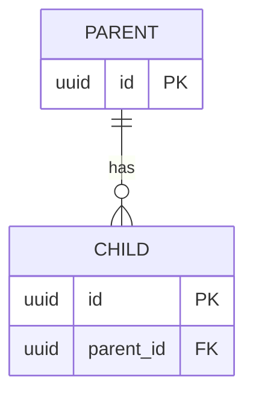

# [Product/Service Name] — Data & API Design

> **When:** Week 3 (Sections 0–2), Week 4 (Sections 3–4) · **Owner:** Architecture Lead (in a team of 4, the Data & API owner) · **Done when:** every item in the SVC Self-Check at the end is true.
>
> **Version:** 1.0
>
> **Approved on:** ___ **by:** Architecture Lead ___ · Product Owner ___ · Delivery Lead ___
>
> **Filled-in Example:** `docs/examples/data-api-design-example.md`

This document turns the Spec's nouns into data and its user actions into endpoints. If the built app and this document disagree, this document wins until it's deliberately changed. Unresolved questions go in the Spec's Open Questions.

---

## 0. Database & Storage

**Database:** *(The real database this design is for, from ADR-00 in `plan.md`, e.g. "PostgreSQL via Supabase.")*

**Build option:** Simulated backend / Real backend *(Simulating? Keep designing for the real database — that's what System Implementation will build. The simulation uses the same entities, field names, and endpoints as this document.)*

**We store:** *(One or two sentences. What must the app remember between visits?)*

**We do NOT store:** *(e.g. "Passwords — login is simulated, or handled by the login service.")*

**Sensitive fields:** *(Personal or private data, and how it's protected. Write "None" if none.)*

*This template assumes a relational database (tables, rows, keys). Using a document database such as MongoDB or Firestore? See the "Document databases" box in `docs/reference/data-api-design-guide.md`.*

---

## 1. Entities

*One table per entity — a thing the app keeps track of, usually a noun from the Spec's scenarios. Every field needs a requirement ID; if no requirement needs it, cut it.*

**Key:** `PK` = identifies each row · `FK → Entity` = points to another entity's PK · `Unique` = no two rows can share this value. For every FK, say what happens when the parent is deleted: **block** it, or **delete** the children too — this is where data gets silently lost if nobody decides.

**Entity: [Name]**

| Field | Type | Key | Required? | Req ID |
|-------|------|-----|-----------|--------|
| id | uuid | PK | Yes | |
| | | | | |

*(Repeat for each entity. 3–6 is typical.)*

---

## 2. Entity Relationship Diagram (ERD)

*Draw every entity in [Mermaid](https://mermaid.js.org/syntax/entityRelationshipDiagram.html) with its keys and relationships. List only PK, FK, and Unique fields — Section 1 holds the rest. Check that it renders at [mermaid.live](https://mermaid.live) before pasting it here.*

*`||--o{` means "one to zero-or-many". See the Mermaid link for other options.*

---

## 3. Normalization Check

- [ ] **1NF** — every field holds one value (no lists or comma-separated values in a field).
- [ ] **2NF** — every field depends on the whole primary key.
- [ ] **3NF** — no field depends on another non-key field (e.g. don't store `event_name` on a photo — store `event_id`).

**Intentional exceptions:** *(Any rule you broke on purpose, and why — or "None".)*

---

## 4. API Endpoints

*One row per user action. The path names a thing (`/v1/photos`); the method says what to do with it (`GET` read, `POST` create, `PATCH` update, `DELETE` remove). If the app has login, list the login endpoints too (e.g. `POST /v1/login`, `GET /v1/me`, `POST /v1/logout`). If a response returns a field that isn't stored (such as a photo `url` built from a file path), say where it comes from.*

| Req ID | Method | Path | Request | Success response | Errors | Who can call it |
|--------|--------|------|---------|------------------|--------|-----------------|
| | | | | | | Anyone / Member / Admin |

*Common status codes: `200` OK · `201` Created · `400` bad input · `401` not logged in · `403` not allowed · `404` not found · `409` conflict (e.g. duplicate).*

---

## SVC Self-Check

- [ ] **Simple** — entities are plain nouns from the Spec; paths are nouns, not verbs (`/photos`, not `/getPhotos`).
- [ ] **Valuable** — every field and endpoint has a requirement ID; anything without one has been cut; sensitive fields are named and protected.
- [ ] **Complete** — the database matches ADR-00; every P1 requirement that stores or reads data has its entity and endpoint; every FK has a delete rule; the ERD renders and shows cardinality; the normalization check is done, with any exception explained; every endpoint says who can call it; the team has approved it.
