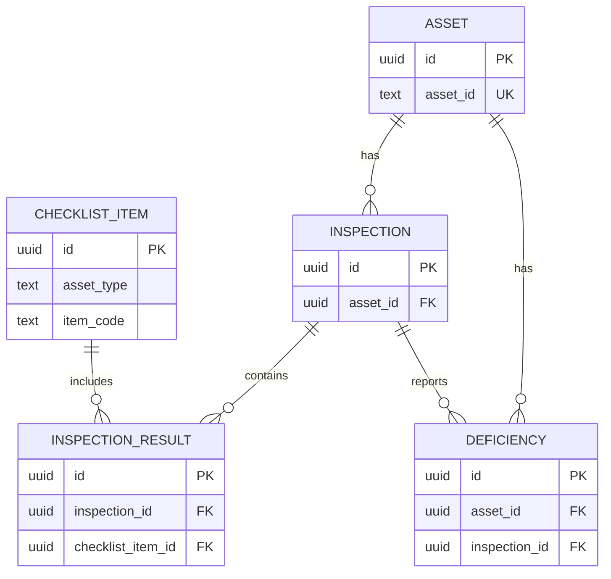

# FieldWorks — Data & API Design

> **When:** Week 3 (Sections 0–2), Week 4 (Sections 3–4) · **Owner:** Architecture Lead (in a team of 4, the Data & API owner) · **Done when:** every item in the SVC Self-Check at the end is true.

> **Version:** 1.0
> **Approved on:** Pending team approval
>
> **Architecture Lead:** Mustafa Almajmaie
>
> **Product Owner:** William Byers
>
> **Delivery Lead:** Quinn Clayburn
> **Filled-in Example:** `docs/examples/data-api-design-example.md`

This document turns the Spec's nouns into data and its user actions into endpoints. If the built app and this document disagree, this document wins until it's deliberately changed. Unresolved questions go in the Spec's Open Questions.

---

## 0. Database & Storage

**Database:** PostgreSQL (proposed relational database for future implementation, as documented in ADR-00 of `plan.md`).

**Build option:** Simulated backend using browser localStorage. The proposed design uses the same entities and field names intended for the relational database.

**We store:** Registered vehicle and equipment assets, preventive maintenance inspection records, checklist items and results, reported deficiencies, severity classifications, resolution notes, timestamps, and readiness-related information. The simulated prototype would retain records in the same browser between visits, provided localStorage is not cleared. Readiness status would be calculated from inspection and deficiency records rather than stored separately.

**We do NOT store:** Passwords, real user authentication credentials, personal identification information, GPS locations, payment information, or unrelated inventory records. Submitted inspection and deficiency history would not be deleted through the application.

**Sensitive fields:** None planned. The design uses fictional demonstration data without personal information. Browser localStorage is not secure storage and would not be appropriate for confidential or real operational maintenance records.

---

## 1. Entities

*One table per entity — a thing the app keeps track of, usually a noun from the Spec's scenarios. Every field needs a requirement ID; if no requirement needs it, cut it.*

**Key:** `PK` = identifies each row · `FK → Entity` = points to another entity's PK · `Unique` = no two rows can share this value. For every FK, say what happens when the parent is deleted: **block** it, or **delete** the children too — this is where data gets silently lost if nobody decides.

**Entity: Asset**

| Field | Type | Key | Required? | Req ID |
|---|---|---|---|---|
| id | uuid | PK | Yes | R1 |
| asset_id | text | Unique (trimmed, case-insensitive) | Yes | R1, R3 |
| name | text | | Yes | R1 |
| type | text (Vehicle or Equipment) | | Yes | R1, R2 |
| model | text | | Yes | R1 |

**Entity: ChecklistItem**

| Field | Type | Key | Required? | Req ID |
|---|---|---|---|---|
| id | uuid | PK | Yes | R6 |
| asset_type | text (Vehicle or Equipment) | | Yes | R6 |
| item_code | text | Unique with asset_type | Yes | R6 |
| description | text | | Yes | R6, R7 |

**Entity: Inspection**

| Field | Type | Key | Required? | Req ID |
|---|---|---|---|---|
| id | uuid | PK | Yes | R9 |
| asset_id | uuid | FK → Asset (on delete: block) | Yes | R9, R11 |
| inspection_date | timestamp | | Yes | R9 |
| status | text (Draft or Submitted) | | Yes | R9, R11 |

**Entity: InspectionResult**

| Field | Type | Key | Required? | Req ID |
|---|---|---|---|---|
| id | uuid | PK | Yes | R7, R9 |
| inspection_id | uuid | FK → Inspection (on delete: block) | Yes | R7, R9, R11 |
| checklist_item_id | uuid | FK → ChecklistItem (on delete: block) | Yes | R6, R7 |
| result | text (Pass, Fail, or N/A) | | Yes | R7 |
| na_reason | text | | Conditional (when N/A) | R7 |

**Entity: Deficiency**

| **Field** | **Type** | **Key** | **Required?** | **Req ID** |
| --- | --- | --- | --- | --- |
| id | uuid | PK | Yes | R8, R9 |
| inspection_id | uuid | FK → Inspection (on delete: block) | Yes | R8, R9 |
| description | text | | Yes | R8 |
| severity | text (Critical or Noncritical) | | Yes | R8, R12, R13 |
| status | text (Open or Resolved) | | Yes | R9, R14, R15 |
| resolution_notes | text | | Conditional (when Resolved) | R14, R15 |
| resolved_at | timestamp | | Conditional (when Resolved) | R14 |
| created_at | timestamp | | Yes | R9 |

---

## 2. Entity Relationship Diagram (ERD)

---

## 3. Normalization Check

- [X] **1NF** — Every field contains a single value. All five FieldWorks entities (Asset, ChecklistItem, Inspection, InspectionResult, and Deficiency) are designed to satisfy 1NF. Inspection results and deficiencies are stored as separate records rather than lists within a single field.
- [x] **2NF** — All five FieldWorks entities use a single-column primary key (id). Therefore, no non-key attribute can depend on only part of a composite primary key, and the design satisfies 2NF.
- [ ] **3NF** — no field depends on another non-key field (e.g. don't store `event_name` on a photo — store `event_id`).

**Intentional exceptions:** *(Any rule you broke on purpose, and why — or "None".)*

---

## 4. API Endpoints

*One row per user action. The path names a thing (`/v1/photos`); the method says what to do with it (`GET` read, `POST` create, `PATCH` update, `DELETE` remove). If the app has login, list the login endpoints too (e.g. `POST /v1/login`, `GET /v1/me`, `POST /v1/logout`). If a response returns a field that isn't stored (such as a photo `url` built from a file path), say where it comes from.*

| Req ID | Method | Path | Request | Success response | Errors | Who can call it |
|--------|--------|------|---------|------------------|--------|-----------------|
| | | | | | | Anyone / Member / Admin |

*Common status codes: `200` OK · `201` Created · `400` bad input · `401` not logged in · `403` not allowed · `404` not found · `409` conflict (e.g. duplicate).*

---

## SVC Self-Check

- [ ] **Simple** — entities are plain nouns from the Spec; paths are nouns, not verbs (`/photos`, not `/getPhotos`).
- [ ] **Valuable** — every field and endpoint has a requirement ID; anything without one has been cut; sensitive fields are named and protected.
- [ ] **Complete** — the database matches ADR-00; every P1 requirement that stores or reads data has its entity and endpoint; every FK has a delete rule; the ERD renders and shows cardinality; the normalization check is done, with any exception explained; every endpoint says who can call it; the team has approved it.
